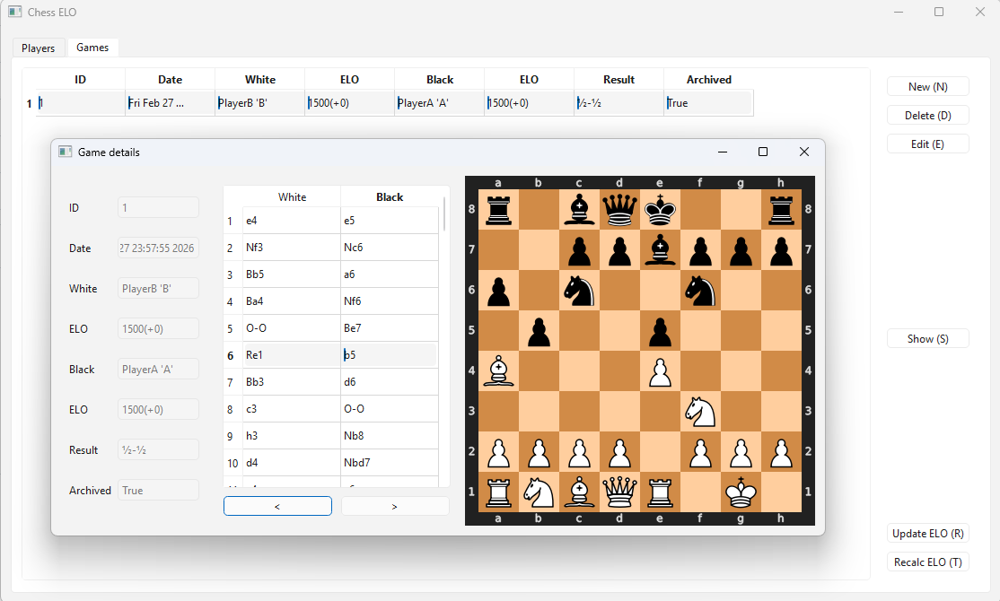

## Chess ELO

Simple Python standalone script with GUI that allows the user to manage ELO points for a group of chess players. Can store specific game in PGN format and visualize it step by step. 

## Setup

- install.bat -> install requirements.txt
- start.bat -> start GUI

## Dependencies
- [chess](https://github.com/niklasf/python-chess)
- PySide6 (Python wrapper for Qt)
